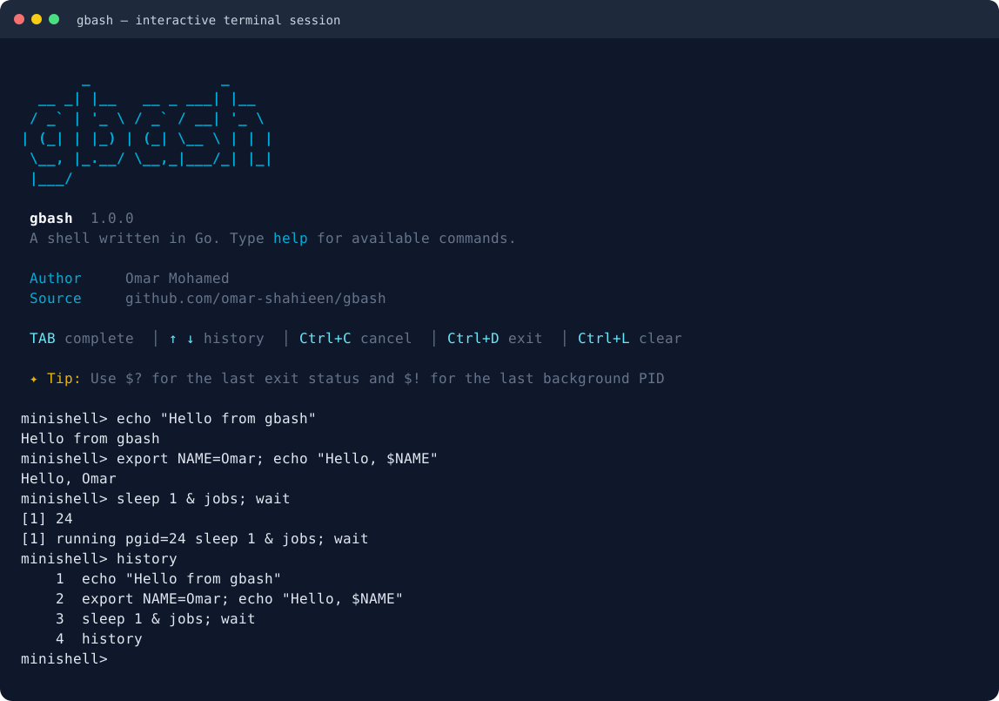

# gbash

A Bash-style shell written in Go for Linux, with interactive completion, persistent history, pipelines, and job control.



*Captured from a running gbash terminal session.*

## Get started

You need Linux and Go 1.27.2 or newer. From the project directory:

```sh
go run .
```

Or build an executable:

```sh
go build -o /tmp/gbash .
/tmp/gbash
```

Inside gbash, use `help` to see the available commands. Use `exit` or press **Ctrl+D** at an empty prompt to leave.

## Features at a glance

| Feature | What you can do |
| --- | --- |
| Interactive editing | Complete words with Tab, edit a command before running it, and cancel input with Ctrl+C. |
| Command history | Recall commands with ↑/↓, search with Ctrl+R, and keep history across sessions. |
| Commands and builtins | Run programs from your `PATH`, change directories, manage exported variables, and inspect commands. |
| Quoting and variables | Use single/double quotes, escapes, `$NAME`, `${NAME}`, `$?`, and `$!`. |
| Pipelines and redirection | Connect commands with `|` and read or write files with redirection operators. |
| Command chains | Run commands sequentially with `;`, after success with `&&`, or after failure with `||`. |
| Job control | Start background jobs with `&`, suspend foreground jobs with Ctrl+Z, and resume them with `bg` or `fg`. |
| Startup banner | See a cyan gbash logo, keyboard shortcuts, and a rotating usage tip. |

## Everyday commands

```sh
pwd
cd /tmp
echo "Hello from gbash"
type echo ls
help
```

| Builtin | Usage |
| --- | --- |
| `cd [directory]` | Change directory; `cd` goes home and `cd -` returns to the previous directory. |
| `pwd` | Print the current directory. |
| `echo [-n] words` | Print text; `-n` omits the final newline. |
| `type command` | Show whether a name is a builtin or an external program. |
| `export NAME=value` | Set an exported environment variable. |
| `unset NAME` | Remove an environment variable. |
| `history` | Show loaded history and commands accepted in the current session. |
| `jobs` | List retained jobs and their states. |
| `fg [%job]` | Bring a job to the foreground; without an argument, select the latest unfinished job. |
| `bg [%job]` | Resume a job in the background. |
| `wait [%job or PID]` | Wait for one job/process, or all jobs without an argument. |
| `help` | Show builtins, operators, and keyboard shortcuts. |
| `exit [status]` | Leave gbash with the given status, or the last command's status. |

## Completion and keyboard shortcuts

Type part of a word, then press **Tab**:

- `ech` → `echo`.
- `cat doc` → a matching file or directory.
- `cd doc` → matching directories.
- `echo $HO` → a matching environment-variable name.

Completion also works after pipes and command separators. Directories get a trailing `/`; filenames containing spaces are escaped or quoted. For multiple matches, Tab extends the common prefix; press Tab again to view/select candidates. Completion covers basic shell words, rather than Bash's programmable, command-specific completion rules.

| Key | Action |
| --- | --- |
| **Tab** | Complete a word or show matching candidates. |
| **↑ / ↓** | Navigate command history. |
| **Ctrl+R** | Search command history. |
| **Ctrl+C** | Cancel the current input, or interrupt a foreground job. |
| **Ctrl+D** | Exit when the input line is empty. |
| **Ctrl+L** | Clear the display while keeping the current input. |
| **Ctrl+Z** | Suspend a foreground job. |

## History across sessions

History is saved to `~/.gbash_history` by default. The latest 1,000 entries are loaded at startup; blank lines and consecutive duplicates are skipped.

Inside gbash:

```sh
echo first
echo second
history
```

To choose a history file, set `HISTFILE` **in your existing terminal before starting gbash**:

```sh
HISTFILE=/tmp/gbash-history go run .
```

To keep history only in memory:

```sh
HISTFILE= go run .
```

## Quotes and variables

```sh
export NAME=Omar
echo "Hello, $NAME"
echo '$NAME stays literal'
echo escaped\ space
echo "${NAME}"
unset NAME
```

Single quotes preserve literal text. Double quotes allow variable expansion. A backslash protects the following character.

Use `$?` to inspect the last command's exit status:

```sh
false
echo $?
```

This prints `1`. A successful command normally returns `0`.

## Pipelines and files

Send one command's output to the next:

```sh
ls | grep .go | wc -l
```

Write, append, and read a file:

```sh
echo first > notes.txt
echo second >> notes.txt
cat < notes.txt
```

Redirect error output separately:

```sh
ls missing-directory 2> errors.txt
cat errors.txt
```

Use `2>> errors.txt` to append errors instead of replacing the file.

## Command chains

Run both commands in order:

```sh
echo first; echo second
```

Run the second command only if the first succeeds:

```sh
true && echo success
```

Run a fallback only if the first fails:

```sh
false || echo fallback
```

## Background jobs

Start a job and continue using the prompt:

```sh
sleep 10 &
jobs
```

Use `$!` for the most recently started background PID:

```sh
sleep 2 &
wait $!
echo finished
```

A whole conditional chain can run in the background:

```sh
sleep 2 && echo done & echo ready
wait
```

Here, `ready` prints immediately and `done` prints after the sleep finishes. Directory and environment changes inside a background chain stay in that child shell.

To try suspension and resuming:

1. Run `sleep 30`.
2. Press **Ctrl+Z** to stop it and return to the prompt.
3. Run `jobs` to see its job ID.
4. Run `bg` to resume it in the background.
5. Run `fg` to bring it back.
6. Press **Ctrl+C** to terminate it and return to the prompt.

Use an explicit job ID when several jobs exist, for example `fg %1`, `bg %1`, or `wait %1`.
